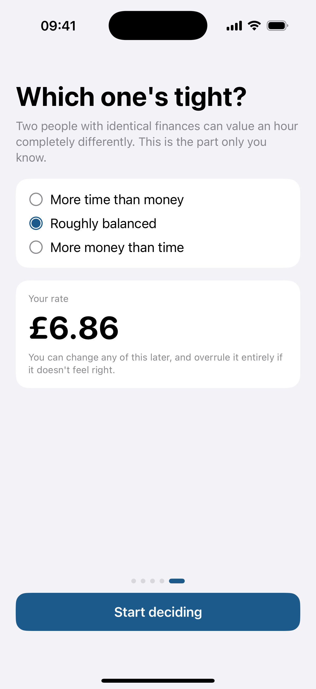
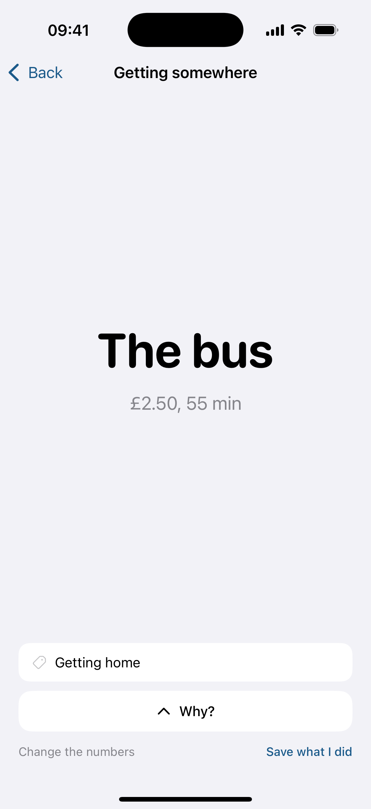
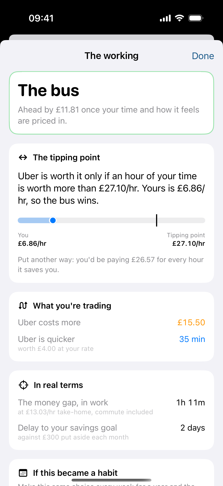
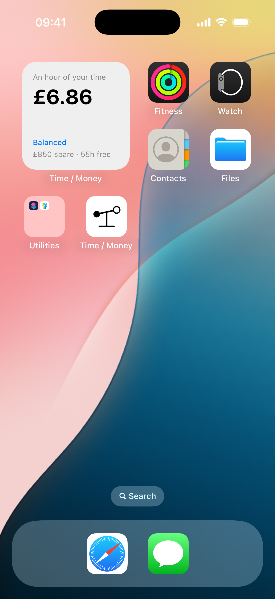

# Time / Money

An iPhone app that settles the everyday decisions where money and time pull against
each other: Uber or the bus, a cleaner or Sunday morning, switch provider or put up
with it.

It works out what an hour of your life is worth to you right now, prices both options
with that, and tells you the answer, plus the one number that still holds if the rate
is wrong.

<p>
  
  
  
  
</p>

<sub>Onboarding · the answer · the working, with its tipping point · the widget. All
figures are from the built-in demo profile (fictional, generic UK: £2,400 a month
take-home), captured on an iPhone 16 Pro simulator.</sub>

---

## The idea

Everything reduces to one number: **what an hour of your life is worth in pounds,
given your situation.** Every decision then becomes

```
true cost =   money + what that money would have become
            + (time × your rate)
            − (how it feels + what it means to others
               + what it does for you + what you learn)
            + what it risks
```

and the lower total wins. Time is adjusted for whether you can use it, whether it
wrecks you and what it displaces; the benefits for how likely they are, how rare the
chance is, and whether you could have them tomorrow anyway.

The rate is built from your own numbers, and every step is shown in the app:

| Step | What it is |
|---|---|
| Effective earned rate | Take-home ÷ *every* hour work takes, commute included (£13.03) |
| Leisure rate | Spare money after rent, bills and savings ÷ genuinely free hours (£3.53) |
| Blend | 35% earned + 65% leisure (£6.86) |
| Scarcity | Time-poor ×1.4, balanced ×1.0, money-poor ×0.7 |
| This week | Busy ×1.25, quiet ×0.8, expires after seven days |
| Deadline pressure | Short of something specific and dated? Up to ×0.6 |

### The output that matters is the tipping point

A rate is the weakest number in the app. So the answer is never just a verdict:

> Uber is worth it only if an hour of your time is worth more than **£27.10**.
> Yours is £6.86, so the bus wins.

That is £18 and 20 minutes against £2.50 and 55 minutes. You can judge whether £27.10
is silly for you even if the model got you to £6.86 and the truth is £13. The tipping
point doesn't depend on the rate at all, which is why it survives a wrong one.

## Highlights

- **A rate model with a point of view.** An *earned* rate (what work yields per hour it
  really takes) and a *leisure* rate (what your spare money buys per free hour) are
  blended, then adjusted for scarcity, a busy week and deadline pressure. You can
  overrule it outright.
- **Usable time versus dead time.** A 55-minute bus you can read on costs 11 effective
  minutes; a 20-minute taxi costs 20. Hours are priced by what they take from you, not
  by the clock.
- **As few questions as possible.** `QuestionPlanner` re-runs each candidate question
  at both ends of its plausible answer and only asks it if the winner could change.
  One screen of four numbers, at most three follow-ups, "good enough, show me" on every
  screen.
- **When it barely matters, just answer.** Inside the noise band it falls back on the
  plainest fact (cheaper, then quicker) instead of "too close to call", which would
  hand the decision straight back.
- **Retrospective reviews.** What you actually chose is recorded; a day later you look
  back in three taps. Regrets adjust the specific term that decided each call, timidly
  and only as an offer.
- **UK PAYE estimate.** Enter a gross salary and get a 2025/26 take-home estimate:
  England/Wales/NI and Scottish bands, NI, salary-sacrifice pension, student-loan plans
  and the £100k allowance taper.
- **Optional integrations.** Two companion apps (Attention, a time tracker, and
  Portfolio, a personal-finance app) can export a backup file; this app can read it to
  replace typed-in estimates with measured ones. Entirely optional, off by default, file
  import only. See [docs/DESIGN.md](docs/DESIGN.md).
- **Private by construction.** On-device only: no network code, no account, no
  analytics. Optional Face ID lock, unattended local backups (restorable from
  Settings), JSON export and restore.
- **A home-screen widget** and Lock Screen controls showing your current rate.

51 preset situations (grouped by how often they come up), each declaring which
questions it can't be answered without. The long version of how this was designed, and
the mistakes it was caught making, is in [docs/DESIGN.md](docs/DESIGN.md).

## Build and run

- Xcode 16.4 or later, Swift 5 language mode.
- iOS 17+. The two Lock Screen controls need iOS 18 and simply don't appear on 17.
- No dependencies, no packages, no network.

```bash
open TimeMoney.xcodeproj    # pick a simulator, press Run
```

It builds and runs on a simulator with no setup. To run on a device, or to use your
own identifiers, set them in **one place**:

```bash
cp Config/Local.example.xcconfig Config/Local.xcconfig   # gitignored
# edit DEVELOPMENT_TEAM and APP_BUNDLE_PREFIX
```

`APP_BUNDLE_PREFIX` (default `com.example.timemoney`) drives the app's bundle id, the
widget's (`<prefix>.widget`), the tests' and the App Group (`group.<prefix>`), through
the entitlements and Info.plists. Nothing else needs editing. The App Group, which the
widget uses to read what the app writes, needs a correctly provisioned team; on a
simulator it works unsigned.

Tests (pure logic, about 80 of them, well under a second):

```bash
xcodebuild test -project TimeMoney.xcodeproj -scheme TimeMoney \
  -destination 'platform=iOS Simulator,name=iPhone 16 Pro' CODE_SIGNING_ALLOWED=NO
```

CI (`.github/workflows/ci.yml`) does the same on `macos-latest`.

## Layout

| Path | What's there |
|---|---|
| `TimeMoney/Model/` | All the logic, with no UI imports: `RateEngine`, `DecisionEngine`, `QuestionPlanner`, `UKTax`, `Review`, `Scenarios`, persistence, backup, formatting |
| `TimeMoney/Views/` | SwiftUI screens: home, decision flow, verdict, settings, review |
| `Shared/` | Code compiled into both the app and the widget: the snapshot the widget draws, App Group lookup, widget intents |
| `TimeMoneyWidget/` | The WidgetKit extension and Lock Screen controls |
| `TimeMoneyTests/` | Unit tests for the model layer, built on worked examples from this README |
| `Config/` | `Base.xcconfig` (bundle prefix, team) and `Local.example.xcconfig` |
| `docs/` | `DESIGN.md` (design rationale and audit log) and screenshots |

## Known judgement calls and limitations

The dials most worth arguing with are all adjustable and documented in
[docs/DESIGN.md](docs/DESIGN.md#known-judgement-calls): the 35/65 blend, enjoyment
fading as `n^0.6`, the £4 / £60 / £40 health, joy and learning anchors, ×2.5 for lost
sleep, and the width of the "too close" band.

- **The rate is a model, not a measurement.** That's why the tipping point is the
  headline. Reviews only ever *offer* a correction.
- **UK only.** Currency is hard-coded to £; the tax estimator covers one PAYE job with
  a standard code. The Living Wage table needs updating each autumn.
- **The audit's headline sweeps are reproduced, not replayed.** The figures quoted in
  `docs/DESIGN.md` came from larger randomised runs. `ScenarioSweepTests` checks the same
  properties over every preset on a fixed grid: at most three follow-ups, no repeats,
  every term of a recurring decision growing with its horizon. On that grid the average
  is 1.6 questions, and about a quarter of decisions are settled with none.
- **Not a financial adviser.** It's a way of thinking out loud about everyday trade-offs.

## Licence

MIT, see [LICENSE](LICENSE).
